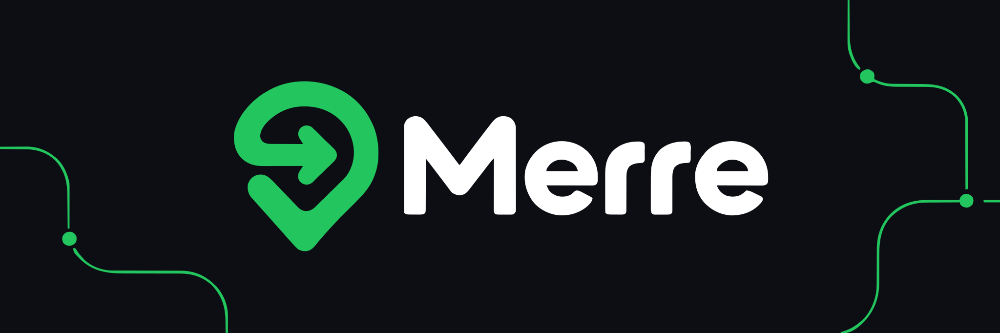

<p align="center">
  
</p>

<p align="center">Élő közlekedési térkép, mobilon és böngészőben.</p>

A Merre a magyar tömegközlekedésben segít: élő járműpozíciókat, megállói indulásokat és érkezéseket, menetrendeket és útvonalakat mutat egy helyen. Az adatokat jelenleg a MÁVPlusz (visszafejtett api-ja) szolgáltatja.

Eredetileg egy personal projektnek indult meg, hogy olyan funkciókat tudjak belerakni amit nem tud vagy a MÁVPlusz vagy a BudapestGO és megprobála a két app közötti különbséget egyesíteni.

## Publikus instance

A Merre egyetlen publikus instance-a a **[merre.bencica.hu](https://merre.bencica.hu)**

## Futtatás

```sh
git submodule update --init
npm ci
npm start
```

Mobilos előnézethez Expo Go használható. Böngészős indítás: `npm run web`.

Natív fejlesztői build: `npm run android` vagy `npm run ios`.

## BudapestGO mobilon

Mobilon be tudsz lépni a BudapestGO-fiókodba, és a Merre-ben is fel tudod mutatni a jegyeidet, bérleteidet. A térképen a jegy ikonból vagy a beállításokból nyílik.

A belépő a hivatalos BKK-fiókoldalon indul, siker után magától visszalép a tárcába. Nem kell visszairányítási URL-t másolnod.

Ha a bérleted még a BPGO-hoz van kötve, belépés után az **Áthozás ide** gombbal át kell venned a Merre-be. A BPGO ezt eszközhöz köti, ezért önmagában a belépés nem elég, ugyanazon a telefonon sem. Utána a régi appban már nem használható. Az áthelyezések száma korlátos, ezért az app előtte rákérdez.

Amit tud:

- Jegy/bérlet felmutatása az ellenőrnek Aztec-kóddal.
- Beszállási Aztec/QR beolvasása és az animált ábra megjelenítése.
- Közeli jármű vagy metróbelépés kiválasztása ugyanahhoz az ábrához.
- Több fiók, sessionimport és fiókexport.

Az érvényes jegyek egy listában vannak, a lejártak a fiókkezelésből nyílnak. Egy használható jegynél rögtön azt mutatja, többnél megjegyzi, melyiket választottad. Hosszú nyomással tudsz másikat választani.

## MÁV mobilon

MÁV-fiókot is hozzáadhatsz a fiókkezelésben. A hivatalos jegy.mav.hu belépő nyílik meg; a Merre a sikeres session ellenőrzése után visszalép a tárcába.

A **Jegyek** és a **Bérletek** külön jelennek meg, a lejártak a fiókkezelésből érhetők el. Bemutatáskor az eredeti MÁV-jegykép látszik. Ha egy konkrét menethez van érvényes jegyed, a járatnál lévő jegyikonból is előveheted; a menetszámot és az időpontot is egyezteti.

A lejárt és egyéb jegyeknél, bérleteknél is van **Megnyitás** gomb az eredeti képhez.

A wrapper helyben, a `vendor/mav-mobile-api` mappában van. A teljes API-leírás és a sessionkezelés a [wrapper README-jében](vendor/mav-mobile-api/README.md) található.

## BudapestGO SDK frissítése

Az SDK Git-submodule a `vendor/budapestgo-api` alatt, forrása: [haverfalat/budapestgo-api](https://github.com/haverfalat/budapestgo-api). Az app a Node-függőségektől mentes `budapestgo-api/mobile` belépési pontot használja helyi csomagfüggőségként.

```sh
git submodule update --init
npm ci
npm run budapestgo:sync
npm start -- --lan
```

Az `npm start` és az `npm run start:dev` frissíti és lefordítja a wrappert. Külön is futtathatod az `npm run budapestgo:sync` paranccsal; a helyi módosításaidat nem írja felül.
